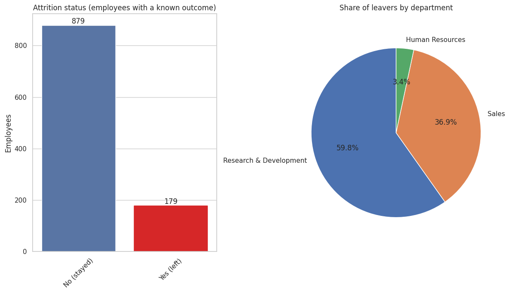
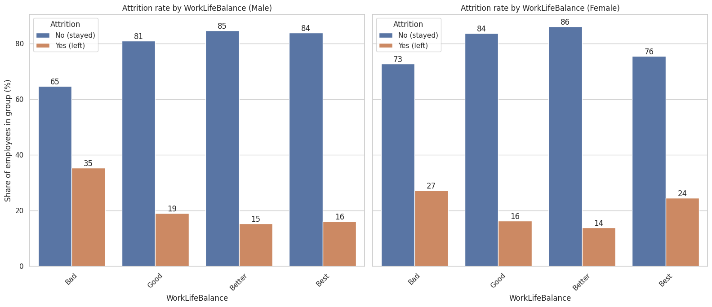
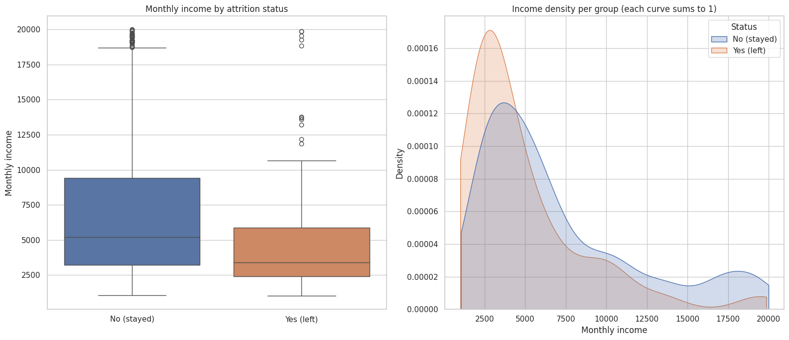
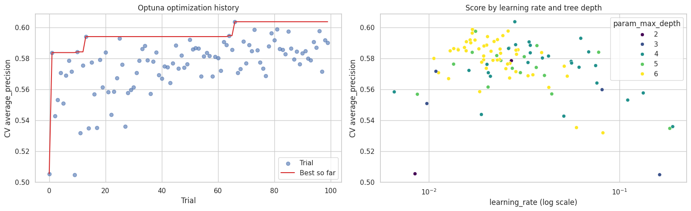
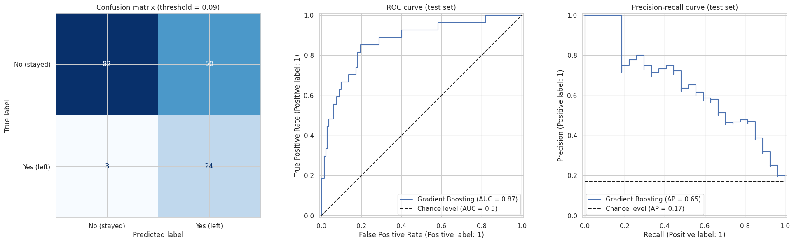
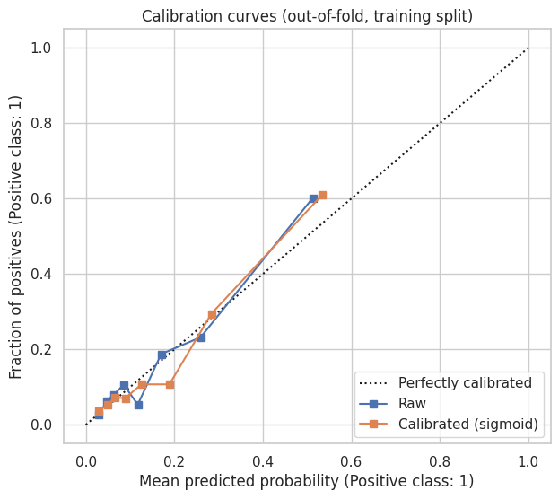

# Employee Attrition Prediction: A Retention Early-Warning System for MurphysBio

Which employees are likely to leave, what is associated with leaving, and whom should HR talk to first?
This project answers those questions with the **IBM HR Analytics Employee Attrition & Performance** sample as
distributed by Dicoding: **1,470 employees**, of whom **179 of the 1,058 with a known outcome left (16.9%)**. It
builds a calibrated **Gradient Boosting** model that ranks the **412 employees without a recorded outcome** by their
risk of leaving and flags the top 20% for a supportive conversation.

The analysis lives in [`notebooks/employee_attrition_prediction.ipynb`](notebooks/employee_attrition_prediction.ipynb).
This README retells the notebook in plain language, section by section, without any code. The exported model, risk
scores and dashboard data power a Streamlit app for HR in [`dashboard/`](dashboard/).

> *MurphysBio is a fictional company. Data: IBM HR Analytics Employee Attrition sample (fictional).*

**Try the app:** run it on your own computer in a few commands (see [How to Run](#how-to-run)). Nothing needs to be
trained: the trained model, the risk scores and the dashboard data are already in the repository.

## At a glance

| Question | Answer |
|---|---|
| How many employees leave? | **16.9%** of the 1,058 employees with a known outcome (179 left, 879 stayed). The other 412 have no recorded outcome; IBM's original file shows that 58 of them (14.1%) left. |
| Who leaves most? | Employees who **work overtime** (31.9% against 10.8% without overtime), are at **job level 1** (27.4%), have **no stock options** (25.7%), are **single** (26.7%), **travel frequently** (24.9%) or rate their **work-life balance as "Bad"** (32.1%). Leavers earn less: median monthly income 3,388 against 5,210 for stayers. |
| What shows no link? | Department, gender, education, education field, performance rating, relationship satisfaction, the size of the last salary increase and the time since the last promotion. |
| How good is the early warning? | Reviewing the **top 20%** of the ranking finds **59%** of the leavers in the test set (precision 0.59) and **67%** of the leavers among 412 employees the model never saw (precision 0.47). On those 412 employees it catches **39 leavers with 83 reviews**; the simple rule "flag everyone who works overtime" catches 29 with 109. |
| What drives the model? | **Overtime**, by a wide margin, then **stock-option level**, environment satisfaction, monthly income, job role and business travel. |
| What should HR do first? | Review **overtime** in high-risk teams, run **stay interviews** with the top 20% of the review list each quarter, benchmark **pay and stock-option eligibility at job levels 1–2**, and review the model's **fairness gaps** (marital status, age) with HR and legal before wider use. |



### How the notebook is organised

The work follows **CRISP-DM**, a standard step-by-step method for data projects: understand the problem, understand
the data, prepare it, build models, evaluate them, and put them to use.

| # | Section | What it covers |
|---|---|---|
| 1 | [Project Overview](#1-project-overview) | Why attrition matters and where the data comes from |
| 2 | [Business Understanding](#2-business-understanding) | Problems, goals, people involved, and how success is measured |
| 3 | [Setup](#3-setup) | The tools used |
| 4 | [Data Understanding](#4-data-understanding) | Data source, quality, exploration and statistical tests |
| 5 | [Data Preparation](#5-data-preparation) | Turning the records into model inputs without leaking test information |
| 6 | [Modelling](#6-modelling) | Baseline, tuning with Optuna, and the decision threshold |
| 7 | [Evaluation](#7-evaluation) | Test results, benchmarks, and a second, improved iteration |
| 8 | [Deployment](#8-deployment) | External validation, fairness check, exported files and the app |
| 9 | [Conclusion and Recommendations](#9-conclusion-and-recommendations) | What it all means and what to do about it |

The notebook departs from the textbook order of CRISP-DM in a few places, on purpose:

* **Statistical tests sit in Data Understanding (Section 4.5).** They describe the data; the test that selects
  features is repeated on the training employees only (Section 5.6).
* **Row-wise features are built before the train/test split (Section 5.2).** Each one uses only values from the same
  employee, so no information crosses the split.
* **Employees without a recorded outcome are kept (Section 5.3).** They cannot be used for training, but they are
  exactly the people the model is meant to score, and IBM's original labels turn them into an external validation set.
* **Evaluation loops back to modelling.** The first model narrowly missed one criterion, so a second iteration
  (Section 7.9) makes every choice on cross-validation and evaluates the final model once more.

---

## 1. Project Overview

**Every employee who leaves takes skills, client relationships and team knowledge out of the door, and replacing that
person is expensive.**

* **Turnover is costly.** Gallup estimates that replacing an employee costs between one-half and two times that
  employee's annual salary, and that 52% of voluntary leavers said their manager or organisation could have done
  something to keep them (McFeely & Wigert, 2019).
* **There is no single cause.** Meta-analytic research links voluntary turnover to job attitudes, the work
  environment, pay and personal circumstances together (Rubenstein et al., 2018).

**About the data.** Dicoding's `employee_data.csv` is a copy of IBM's fictional HR Analytics dataset with an
`EmployeeId` column added and the outcome removed for 412 of the 1,470 employees. A row-by-row comparison confirmed
that every employee matches IBM's original file and that the 1,058 outcomes Dicoding kept agree 100% with IBM's. IBM's
file is used only to supply the withheld outcomes for the external validation (Section 8.3).

**About the company.** The data contain no company name, industry or country. Their profile fits a drug or biotech
company: the largest roles are Sales Executive, Research Scientist and Laboratory Technician; most employees studied
Life Sciences or Medical; and the departments are Research & Development, Sales and Human Resources. The project
therefore names the employer **MurphysBio**, a fictional pharmaceutical and life-sciences company.

---

## 2. Business Understanding

### 2.1 Problem Statements

1. **Which factors are associated with employees leaving?** HR has no evidence-based view of which working
   conditions, job characteristics or pay patterns separate leavers from stayers.
   *At stake:* retention budgets spent on the wrong levers.
2. **Can the risk of leaving be predicted for employees whose outcome is not yet recorded?** HR needs to know which of
   the 412 employees deserve a retention conversation first.
   *At stake:* each avoidable departure costs an estimated 0.5–2× annual salary.
3. **Was a departure voluntary or initiated by the company?** Neither data source records a reason for leaving, so
   this question cannot be answered; it is kept to document the data requirement.

### 2.2 Goals

| Goal | Answers | Success criteria |
|---|---|---|
| **G1.** Identify and quantify the factors most strongly associated with attrition, with statistical support and direction of effect | Problem 1 | B1, D4 |
| **G2.** Build a Gradient Boosting model that ranks employees better than a simple business rule, and score the 412 employees without an outcome | Problem 2 | B2, D1, D2, D3 |
| **G3.** Separate voluntary from involuntary attrition | Problem 3 | B3 (not possible with these data) |

### 2.3 Situation Assessment

The company is fictional, so the stakeholder map is a proposal based on common HR-analytics practice.

| Stakeholder | Decision supported | What they use |
|---|---|---|
| HR Business Partners (**main users**) | Whom to invite for a stay interview this quarter | Retention Review List, Check an Employee |
| Department heads | Workload and overtime planning | Workforce Insights |
| HR Director / Compensation team | Pay-band and career-path policy | Pay and job-level findings |
| People Analytics team | Model maintenance, monitoring and retraining | Notebook, model files, metadata |

**Requirements, assumptions and constraints**

* **Only information known before an employee leaves** may be used.
* **A single snapshot without dates:** the model estimates *who* is at risk, not *when*.
* **Sensitive attributes** (gender, marital status, age) are present; their use in an HR tool needs an HR and legal
  decision.

| Risk | How it is handled |
|---|---|
| Only about 17% leavers, so accuracy looks good even for a useless model | Judge the model on recall, precision, F2 and average precision against two benchmarks |
| 1,058 labelled employees make test results noisy | Stratified split, cross-validation for every choice, bootstrap intervals, external validation on 412 more employees |
| Scores used to penalise employees | Scores are framed as a prompt for supportive conversations only |
| Fictional data | Retrain on real HR data before any real use |

### 2.4 Success Criteria and Evaluation Metrics

All criteria were fixed **before modelling**. A model must beat what HR could do without it: the rule **"flag everyone
who works overtime"**, which on all labelled employees reaches recall 0.547, precision 0.319 and F2 0.479.

**Business criteria**

| ID | Criterion |
|---|---|
| B1 | The top drivers are reported with direction of effect and a statistical test |
| B2 | Every employee without an outcome receives a risk probability and a flag, exported for the app |
| B3 | Voluntary and involuntary attrition can be analysed separately (needs a reason-for-leaving field) |

**Data-mining criteria** (on the held-out test employees)

| ID | Criterion | Why |
|---|---|---|
| D1 | ROC AUC **0.75 or more** | 0.70–0.80 is conventionally read as acceptable discrimination (Hosmer et al., 2013); 0.75 adds a margin |
| D2 | F2 **higher than the overtime rule** | A model that cannot beat one filter adds no value |
| D3 | Average precision **at least 2 × the share of leavers** (≈ 0.34) | A random ranking scores about the share of leavers (≈ 0.17) |
| D4 | Gap between cross-validated and test ROC AUC **0.05 or less** | Checks that results hold on new employees |

**How performance is measured**

* **Recall:** of all employees who leave, the share the model flags. Missing a leaver is the costliest error.
* **Precision:** of all flagged employees, the share who actually leave. Low precision wastes HR time.
* **F2:** a balance of precision and recall that weighs recall twice as much.
* **ROC AUC:** the probability that a random leaver gets a higher risk score than a random stayer (0.5 = random).
* **Average precision:** the area under the precision-recall curve; more informative than ROC AUC when leavers are
  rare (Saito & Rehmsmeier, 2015).

### 2.5 Solution Approach

* **Describe:** attrition *rates* by group, distributions and correlations.
* **Test:** Mann-Whitney U and Welch t-tests (with Benjamini-Hochberg adjustment) for 14 numeric features, and
  chi-square tests with Cramér's V for 16 categorical and coded features.
* **Predict:** a **Gradient Boosting** classifier (Friedman, 2001) in a scikit-learn pipeline, tuned with **Optuna**
  (Akiba et al., 2019) over 100 trials.
* **Explain:** permutation importance on unseen employees, read together with the exploration for direction of effect.

---

## 3. Setup

This section only prepares the working environment.

* **Tools:** Python with **pandas** and **NumPy**, **Matplotlib** and **seaborn** for charts, **SciPy** for the
  statistical tests, **scikit-learn** for preparation and modelling, **Optuna** for tuning and **joblib** for saving
  the model.
* **Version checks:** the notebook stops with a clear message if a library is too old. The stored outputs come from a
  run with Python 3.13, scikit-learn 1.6.1, pandas 2.2.3 and Optuna 5.1.0.
* **One place for settings:** the random seed, file paths, thresholds, the Optuna search space and the fairness rule
  are all defined once, in Section 3.2.

---

## 4. Data Understanding

### 4.1 Data Source

| Dataset | One row per | Rows | Columns | What it contains |
|---|---|---|---|---|
| `employee_data.csv` (Dicoding Academy, n.d.) | Employee (single snapshot, no dates) | 1,470 | 35 | Demographics, job characteristics, pay, tenure, satisfaction surveys and `Attrition` (1 = left, 0 = stayed, empty = unknown) |
| `emp_attrition.csv` (IBM, n.d.) | Employee | 1,470 | 35 | IBM's original file; used only for the external validation |

### 4.2 Data Description and Quality

* **Missing values:** only `Attrition`, for **412 employees (28%)**. They are not imputed: guessing an outcome would
  inject assumptions into the target. They become the scoring set instead.
* **No variance:** `EmployeeCount`, `Over18` and `StandardHours` have a single value and are dropped.
* **Duplicates:** none, by row or by `EmployeeId`.
* **Coded scales:** education, satisfaction, involvement, work-life balance and performance are ordered survey scales
  (for example 1 = Bad … 4 = Best for work-life balance), so they are kept as ordered numbers rather than averaged as
  measurements.
* **Undocumented units:** neither IBM nor Dicoding names the currency of the pay columns, so pay is only compared
  relative to itself.

### 4.3 Exploring the Data

The exploration answers four questions:

1. How large is attrition, and does it differ across departments and gender?
2. Do work-life balance and job satisfaction separate leavers from stayers?
3. How does pay relate to department, role, experience and attrition?
4. Which numeric features are redundant or skewed, and what does that mean for modelling?

Most findings use the **attrition rate**: the share of employees in a group who left. A group's *share of leavers*
mostly mirrors its size, so conclusions about risk are drawn from rates.

#### How many employees leave, and where?

* **About one in six** employees with a known outcome left (179 of 1,058).
* **Research & Development has the most leavers (59.8%), but Sales has the highest rate** (20.7%, against 15.8% in
  Human Resources and 15.3% in R&D). R&D simply has the most employees.
* **Department and gender differences are not statistically significant** (chi-square p = 0.10 and 0.66). The largest
  gap, women in Human Resources at 25%, rests on 3 leavers out of 12.

**What this means:** a model that always predicts "stayed" is already 83% accurate, so accuracy cannot be the success
measure, and the data must be split in a stratified way.

#### Work-life balance and job satisfaction

* **A "Bad" work-life balance goes with about twice the average rate** (32.1% against 16.9%), but only 56 labelled
  employees chose that answer.
* **"Very High" job satisfaction has the lowest rate** for both women (10.2%) and men (12.3%). "High" is the most common
  answer among leavers only because it is the most common answer overall.



#### Pay

* **Leavers earn about one-third less:** median monthly income 3,388 against 5,210 for stayers, and lower in every
  department-gender group.
* **Pay is tiered by role and job level.** Managers and Research Directors earn medians above 16,000; Sales
  Representatives, Laboratory Technicians, Research Scientists and HR staff earn about 2,600–3,100. Job level 1 has an
  attrition rate of 27.4%, against 5–15% at higher levels.
* **Pay alone is not decisive:** several leavers earn between about 11,800 and 19,900.



#### Redundant and skewed features

* **Seven pairs of numeric features are strongly correlated** (r ≥ 0.6), almost all measures of time: income and
  total working years (0.77), years at the company and years with the current manager (0.77), and so on.
* **Nine features are right-skewed.** Decision trees split on thresholds, so neither correlation nor skew needs
  treatment for Gradient Boosting; both only affect how importance is read.

### 4.4 Statistical Tests

* **Numeric features:** seven of 14 differ significantly between leavers and stayers after adjustment. Leavers have
  shorter careers (median 7 against 10 years), lower income, shorter tenure (3 against 6 years), are younger (31
  against 36) and live slightly farther away. The size of the last salary increase and the time since the last
  promotion show **no** association.
* **Categorical features:** 10 of 16 are significant. The strongest are **overtime**, job role, job level,
  stock-option level and marital status, followed by job involvement, environment satisfaction, business travel, job
  satisfaction and work-life balance.

These are associations, not causes, and several of them describe one overlapping "early-career, lower-paid" profile.

### 4.5 From Exploration to Preparation

| What the exploration found | What the preparation does |
|---|---|
| Three columns have no variance; `EmployeeId` is an identifier | Drop the constant columns; keep the ID as an index, never as a feature |
| Tenure features are related; career stagnation is plausible | Build three career-dynamics features and test them |
| 412 employees have no outcome | Keep them as a separate scoring and validation set |
| Only 16.9% leavers | Stratified split and stratified cross-validation; a recall-weighted threshold |
| Six categorical features show no association | Repeat the chi-square screen on the training employees only and drop them |
| Skewed features; trees ignore monotonic transforms | No log transform and no scaling |
| Gender, marital status and age are sensitive | A switch to exclude them, tested in iteration 2 |

---

## 5. Data Preparation

Preparation follows four leakage-safe phases: steps that use only one employee's row run before the split, and
everything that *learns* from data (encoding, feature screening, tuning, threshold) is fitted on the training
employees only.

* **Phase A: before the split.** Drop the three constant columns; build three features (longest time without a
  change in role, promotion or manager; years at previous employers; trainings per year at the company); separate the
  1,058 labelled from the 412 unlabelled employees; export `data/processed/employee.csv` for the dashboard.
* **Phase B: stratified split.** 85% of the labelled employees (899) for training and model selection, 15% (159, of
  whom 27 left) locked away as the test set. Both parts keep a 17% share of leavers.
* **Phase C: learning from the training employees only.** The chi-square screen, repeated on the training split,
  removes the same six features as in Section 4.4 (department, education, education field, gender, performance rating,
  relationship satisfaction), leaving 27 features.
* **Phase D: ready for modelling.** One-hot encoding of the nominal columns sits **inside** the model pipeline, so it
  is refitted in every cross-validation fold, and the saved model accepts raw employee records. The 27 features become
  40 model columns.

The engineered features turned out to re-express short tenure rather than career stagnation: leavers are newer, not
stuck. Iteration 2 removes them without any loss (Section 7.9).

---

## 6. Modelling

**Gradient Boosting** builds small decision trees one after another, each correcting the errors of the previous ones
(Friedman, 2001). It handles mixed feature types and interactions (for example overtime combined with low pay) and
needs no scaling.

| Step | Result (10-fold cross-validation on the 899 training employees) |
|---|---|
| Baseline with default settings | Average precision **0.533**, ROC AUC 0.798 |
| **Optuna**, 100 trials (best trial 66) | Average precision **0.604**, ROC AUC 0.815: 200 trees, learning rate 0.028, depth 4, at least 28 employees per leaf, 87% of rows per tree |
| Decision threshold maximising F2 | **0.086**: an employee is flagged from a 9% predicted risk |

The search converged: after trial 13 the best score improved by only 0.010, about a tenth of the fold-to-fold
variation. Both Optuna records are saved as flat JSON files in `artifacts/tuning/`.



---

## 7. Evaluation

### 7.1 First Iteration: Test Results

The 159 test employees (27 leavers) were used once, after every choice had been fixed.

| Measure | Nobody leaves | Overtime rule | Gradient Boosting (iteration 1) |
|---|---|---|---|
| Recall | 0.000 | 0.593 | **0.889** |
| Precision | 0.000 | 0.356 | 0.324 |
| F2 | 0.000 | 0.523 | **0.659** |
| Share flagged | 0% | 28.3% | 46.5% |
| ROC AUC | — | — | **0.869** |
| Average precision | — | — | **0.653** |

The model catches **24 of 27 leavers**, eight more than the overtime rule, at similar precision, but it flags almost
half of the employees. **D1, D2 and D3 are met; D4 is narrowly missed**: the test ROC AUC is 0.054 *higher* than the
cross-validated value, which with 27 test leavers most likely reflects a favourable test sample.



**What the first model relies on.** Shuffling **overtime** lowers average precision by about 0.18, roughly four times
more than any other feature. Environment satisfaction, stock-option level, business travel, job satisfaction, age, job
role and income form a second tier.

**Decision (iteration 1): a limited pilot, after a second iteration** that addresses five review points: the small
test set, the long flag list, probability calibration, the engineered features and the sensitive attributes.

### 7.2 Second Iteration: The Final Model

Every iteration-2 choice is made on the training employees with **repeated cross-validation** (10 folds × 5 repeats).

1. **Feature set.** The four candidate feature sets perform the same within noise (average precision 0.584–0.590),
   so the smallest one is kept: **22 features, without the engineered features, marital status and age** (gender had
   already been removed by the screen).
2. **Calibration.** Sigmoid (Platt) calibration lowers the Brier score from 0.1081 to 0.1063 and brings the mean
   predicted risk (0.171) close to the observed share of leavers (0.169), so probabilities can be shown to HR as
   approximate percentages.
3. **Capacity-based flag.** Instead of the F2 threshold, HR reviews the **top 20%** of each scoring round. On
   out-of-fold predictions, the top 20% finds 58% of leavers at 49% precision; widening to 30% or 40% adds only 6–12
   points of recall per step. For a single employee, the top 20% translates into a probability cut-off of 0.268.



**Final results on the 159 test employees**

| Measure | Overtime rule | Iteration 1 (F2 threshold) | **Iteration 2 (top 20%)** |
|---|---|---|---|
| Reviews | 45 | 74 | **27** |
| Leavers caught | 16 | 24 | **16** |
| Precision | 0.356 | 0.324 | **0.593** |
| Recall | 0.593 | **0.889** | 0.593 |
| ROC AUC | — | 0.869 | 0.852 |
| Average precision | — | 0.653 | **0.663** |

Iteration 2 ranks as well as iteration 1 (the bootstrap intervals overlap almost entirely) and catches the same 16
leavers as the overtime rule with 27 instead of 45 reviews. **All four criteria are now met:** ROC AUC 0.852,
F2 0.593 against 0.523, average precision 0.663 against 0.340, and a cross-validation to test gap of 0.048.

**Decision:** the iteration-2 model replaces iteration 1 and goes to a one-quarter pilot in which HR Business Partners
review every flagged employee.

---

## 8. Deployment

### 8.1 Refit and Scoring

The final model is refitted on all 1,058 labelled employees. Its top-20% probability cut-off is **0.262**. Each of the
412 employees without an outcome receives a probability, a rank and a flag; the **top 83 are flagged** for review.
The ten highest-ranked are all at job level 1, nine of them work overtime, and all earn between 1,569 and 3,172 per
month.

### 8.2 External Validation and Fairness Check

IBM's original file recovers the outcomes of the 412 scored employees: **58 of them left**. The model never saw them,
and their outcomes were never used for any choice.

| Measure | Overtime rule | **Deployed model** |
|---|---|---|
| Share flagged | 26.5% | **20.1%** |
| Recall | 0.500 | **0.672** |
| Precision | 0.266 | **0.470** |
| F2 | 0.425 | **0.619** |
| ROC AUC | — | 0.828 |
| Average precision | — | 0.616 |

The ranking holds up on new employees (ROC AUC 0.828 against 0.852 on the test set).

**Fairness (four-fifths rule, 29 C.F.R. § 1607.4).** Women and men are flagged at the same rate (20.0% against 20.2%).
Marital status and age still fail the check: single employees are flagged at 40.7% against 11.5–12.9% for married and
divorced employees, and employees under 30 at 40.0% against 12.3–16.2% for older groups. Marital status and age are not
model inputs; the gaps come through correlated features such as stock-option level (every employee whose marital status
is Single has stock-option level 0) and career length. **They trigger an HR and legal review before wider use.**

**What the deployed model relies on.** Overtime (a drop of 0.21 in average precision when shuffled) and stock-option
level (0.12) lead, followed by environment satisfaction, monthly income, job role and business travel.

### 8.3 Exported Files

* `artifacts/trained_models/gradient_boosting_pipeline.joblib`: encoding, calibrated Gradient Boosting and the
  top-20% cut-off in one pipeline, which accepts raw employee records.
* `artifacts/trained_models/model_metadata.json`: features, cut-off, settings and test results.
* `artifacts/trained_models/feature_schema.json`: type, allowed categories and range of every input, for forms and
  upload checks.
* `artifacts/trained_models/model_card.json`: criteria, benchmarks, bootstrap intervals, external validation,
  fairness check and permutation importance.
* `artifacts/tuning/`: the best Optuna trial and the full trial log.
* `data/processed/employee.csv` (dashboard data) and `data/processed/employee_risk_scores.csv` (review list).

**Monitoring** (owner: People Analytics team): each quarter, compare predicted risk with actual departures, watch the
key inputs for drift (overtime share, income, job-level mix), retrain when recall falls below the overtime rule, and
re-run the four-fifths check by gender, age band and marital status.

### 8.4 The HR App

The Streamlit app reads only the exported files, so it never retrains the model. It applies the same pipeline and
top-20% rule as the notebook.

| Page | Question it answers | Main users |
|---|---|---|
| **Workforce Insights** | Where does attrition concentrate (job role, level, overtime, pay band and more)? Filterable by department | Department heads, HR Director |
| **Retention Review List** | Which employees without a recorded outcome should HR talk to first? Ranked by risk, with the top 20% flagged; filters never change the ranking, and the CSV download carries the data notice | HR Business Partners |
| **Check an Employee** | How likely is one employee to leave, and what changes with a what-if (for example without overtime)? A second tab scores a CSV file of employees (sample files included) | HR Business Partners, People Analytics team |
| **How the Model Works** | How reliable is the model, how does it compare with the overtime rule, how did it do on 412 unseen employees, and where are its limits? | All |

**Intended use.** Risk scores support supportive conversations such as stay interviews. A high score is a prompt to
talk, never a basis for disciplinary action, pay decisions or dismissal. Every page and download carries the data
notice.

**Design and accessibility.** The app uses MurphysBio's "Molecular M" logo and a teal palette with the self-hosted
Inter font. Text meets WCAG 2.2 AA contrast; review status is always an icon plus words, never colour alone; every
chart has a legend and a "Show as table" alternative; controls are at least 44 px tall; and pages are readable at
375 px width.

---

## 9. Conclusion and Recommendations

### 9.1 Conclusion

**In one sentence:** attrition in the fictional MurphysBio workforce is concentrated among employees who work
overtime, are early in their careers and paid less, sit at entry level, have no stock options or report low
satisfaction, and a calibrated Gradient Boosting model that reviews the top 20% of employees finds 59% of the leavers
on the test set and 67% of the leavers among 412 employees it never saw.

* **Drivers (G1).** Overtime is the strongest factor in the tests and in the model. Job level 1, lower income, an
  early-career profile, no stock options, frequent travel, single marital status, a "Bad" work-life balance and low
  satisfaction are also significantly associated with leaving.
* **Prediction (G2).** All four data-mining criteria are met by iteration 2, and the external validation confirms that
  the ranking generalises.
* **Reason for leaving (G3).** Not achievable: neither data source records why an employee left.

### 9.2 Were the Problems Addressed?

1. **Which factors: addressed** [B1]. Rates, statistical tests and permutation importance agree on overtime as the
   main driver.
2. **Predicting risk: addressed** [B2, D1–D4]. The model beats the overtime rule on the test set and on 412 external
   employees, and the review list is exported for the app.
3. **Voluntary or not: not addressed** [B3]. It requires a reason-for-leaving field.

### 9.3 Recommendations

Because the evidence is associational, each action should be piloted and measured before a full rollout.

1. **Review overtime allocation** in teams with high overtime and high predicted risk. *Who: department heads.*
   Overtime roughly triples the attrition rate (31.9% against 10.8%).
2. **Run stay interviews each quarter** with the top 20% of the review list, starting with Sales and level 1 roles.
   *Who: HR Business Partners.*
3. **Benchmark pay within job level and department**, and review stock-option eligibility for levels 1–2. *Who: HR
   Director and Compensation team.* Leavers earn less than stayers in every department-gender group, and employees
   without stock options leave at 25.7%.
4. **Define a clear promotion path out of level 1.** *Who: HR Director.* Level 1 attrition is 27.4% against 5–15%
   above it.
5. **Follow up on the lowest survey answers** (work-life balance, environment satisfaction) and review
   frequent-travel assignments. *Who: HR Business Partners and department heads.*
6. **Record the reason for leaving and the exit date** for every departure, retrain quarterly and run the four-fifths
   check. *Who: People Analytics team.*
7. **Decide with HR and legal** whether stock-option eligibility should remain a model input, given the remaining
   gaps by marital status and age. *Who: People Analytics team and HR Director.*

### 9.4 Limitations

* **Fictional data and company.** Patterns cannot be transferred to a real company without retraining on its data.
* **Withheld rather than unknown outcomes.** The 412 "unrecorded" outcomes were removed by Dicoding and are known in
  IBM's file; they are used only for validation.
* **A single snapshot without dates.** The model cannot say *when* someone will leave.
* **Few leavers.** About 180 leavers (27 in the test set) limit how precisely the results can be estimated, and the
  test set was used twice (once per iteration).
* **Associations, not causes.** Neither the tests nor permutation importance establish causality.
* **Fairness.** Flag rates by marital status and age still fail the four-fifths check through correlated features.

---

## How to Run

**The quickest way:** start the app on your own computer. Nothing needs to be trained: the repository already includes
the trained model in `artifacts/trained_models/` and the dashboard data and risk scores in `data/processed/`.

### What you need

* **Python 3.13.** The model was saved with **scikit-learn 1.6.1**, which has no Python 3.14 wheels, so the pinned
  versions in the requirements files matter.
* **Git**, to download the repository.

### 1. Download the project

```bash
git clone https://github.com/DcMurphys/pharma-employee-attrition-prediction.git
cd pharma-employee-attrition-prediction
```

### 2. Install the dependencies

Create a separate Python environment, so the project does not affect other Python work on your computer:

```bash
python3.13 -m venv .venv
source .venv/bin/activate          # Windows: .venv\Scripts\activate
pip install -r requirements-dev.txt
```

`requirements-dev.txt` installs the app, the tests, linting and the notebook extras. To install only what the app
needs, use `pip install -r requirements.txt`. Conda users can create an equivalent environment from `environment.yml`.

### 3. Start the app

```bash
streamlit run dashboard/app.py
```

The app opens at http://localhost:8501. The batch tab of **Check an Employee** includes sample files, so it can be
tried without real data.

### 4. Run the tests (optional)

The tests check the architecture rules, that the app's constants and every displayed result match the exported
artifacts, scoring parity with the notebook, every page (including missing-artifact cases), batch scoring with the
sample files, and the accessibility rules.

```bash
python -m pytest
ruff check . && ruff format --check .
```

### 5. Re-run the analysis (optional)

Open `notebooks/employee_attrition_prediction.ipynb` in Jupyter or Google Colab (the first cell installs Optuna on
Colab). A full run repeats the 100 Optuna trials and re-exports the model files, the tuning records and the files in
`data/processed/`; after any retraining, update the figures in this README.

### 6. Deploy (optional)

* **Streamlit Community Cloud.** Create an app from the repository with the main file `dashboard/app.py` and choose
  **Python 3.13** under *Advanced settings*. Dependencies come from `dashboard/requirements.txt`, and the theme and
  self-hosted fonts from `.streamlit/config.toml`. The app needs no secrets.
* **Uploaded files** are processed in memory and not stored; use sample or synthetic data only.

### Project layout

| Folder | Contents |
|---|---|
| `notebooks/` | The analysis notebook, the source of every number in this README |
| `data/` | `raw/` (Dicoding's and IBM's files), `processed/` (dashboard data and risk scores) |
| `artifacts/` | `trained_models/` (pipeline, metadata, input schema, model card), `tuning/` (Optuna records) |
| `dashboard/` | The Streamlit app in a Model-View-Controller layout: `models/` (artifact loading, validation and scoring, no Streamlit), `controllers/` (page logic and caching), `views/` (page rendering), `page_scripts/` (one entry file per page), plus the logo and fonts |
| `src/employee_attrition/` | Shared configuration and decision rules used by the notebook and the app |
| `tests/` | Automated tests |
| `reports/figures/` | Charts from the notebook used in this README |
| `.streamlit/` | App theme and fonts |

---

## Glossary

| Term | Meaning |
|---|---|
| **Attrition rate** | The share of employees in a group who left. |
| **Share of leavers** | The share of all leavers who belong to a group; mostly reflects the group's size. |
| **Data leakage** | Giving a model information it would not have when making a real prediction; it makes results look better than they are. |
| **Stratified split** | Dividing employees into training and test sets while keeping the share of leavers the same in both. |
| **Cross-validation** | Testing a model several times, each time training on part of the data and checking on the rest. |
| **Out-of-fold prediction** | A prediction for a training employee made by a model that did not see that employee. |
| **Chi-square test** | A test of whether the attrition rate differs between the categories of a characteristic. |
| **Mann-Whitney U test** | A rank-based test of whether a numeric characteristic differs between leavers and stayers. |
| **Cramér's V** | The strength of a link between two categories, from 0 (none) to 1 (perfect). |
| **Gradient Boosting** | A method that builds many small decision trees one after another, each correcting the previous ones. |
| **Optuna** | A tool that searches for good model settings efficiently. |
| **Recall / precision** | The share of leavers the model flags / the share of flagged employees who actually leave. |
| **F2** | A balance of precision and recall that weighs recall twice as much. |
| **ROC AUC** | The probability that a random leaver is ranked above a random stayer. |
| **Average precision** | The area under the precision-recall curve. |
| **Calibration** | Adjusting probabilities so that, among employees scored at 30%, about 30% actually leave. |
| **Brier score** | The mean squared difference between predicted probability and outcome; lower is better. |
| **Permutation importance** | How much worse the model gets when one characteristic is shuffled. |
| **Four-fifths rule** | A screening rule: each group's flag rate should be at least 80% of the highest group's rate. |
| **CRISP-DM** | A standard step-by-step method for data projects. |

---

## References

Citations follow APA 7th edition.

### Industry reports and official documents

McFeely, S., & Wigert, B. (2019, March 13). *This fixable problem costs U.S. businesses $1 trillion*. Gallup.
https://www.gallup.com/workplace/247391/fixable-problem-costs-businesses-trillion.aspx

Uniform Guidelines on Employee Selection Procedures (1978), 29 C.F.R. § 1607.4 (2024).
https://www.govinfo.gov/content/pkg/CFR-2024-title29-vol4/pdf/CFR-2024-title29-vol4-sec1607-4.pdf

### Scientific papers and books

Akiba, T., Sano, S., Yanase, T., Ohta, T., & Koyama, M. (2019). Optuna: A next-generation hyperparameter optimization
framework. In *Proceedings of the 25th ACM SIGKDD International Conference on Knowledge Discovery & Data Mining*
(pp. 2623–2631). https://doi.org/10.1145/3292500.3330701

Friedman, J. H. (2001). Greedy function approximation: A gradient boosting machine. *The Annals of Statistics, 29*(5),
1189–1232. https://doi.org/10.1214/aos/1013203451

Hosmer, D. W., Jr., Lemeshow, S., & Sturdivant, R. X. (2013). *Applied logistic regression* (3rd ed.). Wiley.
https://doi.org/10.1002/9781118548387

Rubenstein, A. L., Eberly, M. B., Lee, T. W., & Mitchell, T. R. (2018). Surveying the forest: A meta-analysis,
moderator investigation, and future-oriented discussion of the antecedents of voluntary employee turnover.
*Personnel Psychology, 71*(1), 23–65. https://doi.org/10.1111/peps.12226

Saito, T., & Rehmsmeier, M. (2015). The precision-recall plot is more informative than the ROC plot when evaluating
binary classifiers on imbalanced datasets. *PLOS ONE, 10*(3), Article e0118432.
https://doi.org/10.1371/journal.pone.0118432

### Data sets and software

Dicoding Academy. (n.d.). *employee_data.csv* [Data set]. GitHub.
https://github.com/dicodingacademy/dicoding_dataset/tree/main/employee

IBM. (n.d.). *emp_attrition.csv* [Data set]. In *employee-attrition-aif360*. GitHub.
https://github.com/IBM/employee-attrition-aif360

Pavansubhash. (2017). *IBM HR Analytics Employee Attrition & Performance* [Data set]. Kaggle.
https://www.kaggle.com/datasets/pavansubhasht/ibm-hr-analytics-attrition-dataset

Pedregosa, F., Varoquaux, G., Gramfort, A., Michel, V., Thirion, B., Grisel, O., Blondel, M., Prettenhofer, P.,
Weiss, R., Dubourg, V., Vanderplas, J., Passos, A., Cournapeau, D., Brucher, M., Perrot, M., & Duchesnay, É. (2011).
Scikit-learn: Machine learning in Python. *Journal of Machine Learning Research, 12*, 2825–2830.

---

## License

The code in this repository is released under the [MIT License](LICENSE), © 2026 Dwi Cahaya Dharma.

The licence does not cover material owned by others:

* **Data:** the IBM HR Analytics Employee Attrition & Performance sample is a fictional dataset created by IBM and
  distributed by Dicoding; the files in `data/processed/` are derived from it.
* **Fonts:** Inter in `dashboard/static/fonts/` is licensed under the SIL Open Font License 1.1 (see
  `Inter-LICENSE.txt`).
* **Company:** MurphysBio, its name and its "Molecular M" logo are fictional and created for this portfolio.
